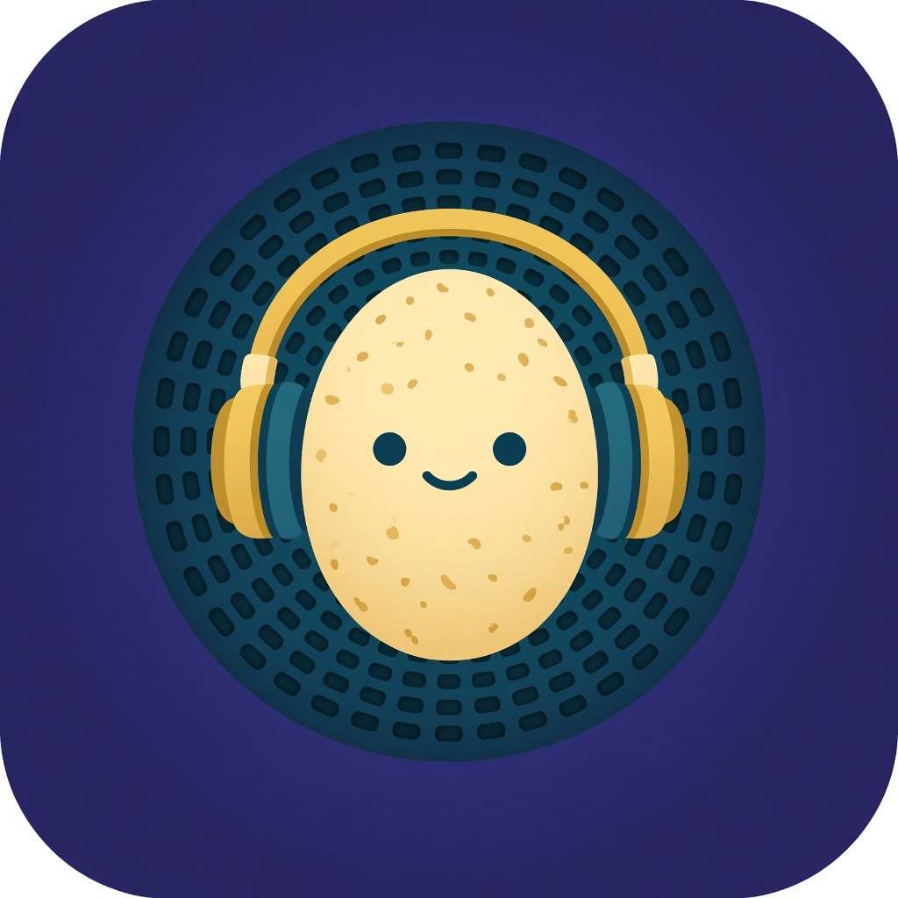
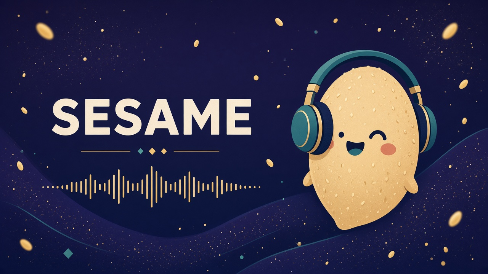

<p align="center">
  
</p>

<h1 align="center">Sesame</h1>

<p align="center">
  <strong>Bot de Discord de música y voz.</strong><br>
  Entra al canal, pone canciones y lee el chat en voz alta.<br>
  Mientras habla, baja la música — no la para.
</p>

<p align="center">
  <a href="https://discord.com/oauth2/authorize?client_id=1575009817263874148&permissions=2181656960&scope=bot%20applications.commands"></a>
  <a href="LICENSE"></a>
</p>

<p align="center">
  
</p>

## Qué es

Sesame es un bot **público y open source**. Cualquier persona puede añadirlo a su servidor. No hace falta instalar nada: pulsa **Invitar a Sesame**, elige el servidor y usa `/play` o `!help`.

- Reproduce audio (búsqueda o enlace de YouTube).
- Lee el chat en voz alta (`!tts_on`) y **atenúa** la canción mientras habla.
- Cola, volumen, skip y auto-salida si el canal se queda vacío.
- Comandos con `!` y con `/`.

**Invitación (cualquier servidor):**  
https://discord.com/oauth2/authorize?client_id=1575009817263874148&permissions=2181656960&scope=bot%20applications.commands

Quien invite necesita permiso de **Gestionar servidor**. Intents en el portal: Message Content, y el bot marcado como **Public Bot**.

## Comandos

| Comando | Qué hace |
| --- | --- |
| `!help` / `/help` | Lista todos los comandos |
| `!play <búsqueda o enlace>` / `/play` | Encola y reproduce |
| `!skip` / `/skip` (`!next`, `!siguiente`) | Siguiente de la cola |
| `!stop` / `/stop` | Para todo y vacía la cola |
| `!queue` / `/queue` | Qué suena y qué sigue |
| `!nowplaying` / `/nowplaying` | Pista actual y volumen |
| `!volume <0-100>` / `/volume` | Volumen |
| `!leave` / `/leave` | Sale del canal de voz |
| `!tts_on` / `/tts_on` | Lee este canal (baja la música) |
| `!tts_off` / `/tts_off` | Deja de leer el chat |
| `!test_audio` / `/test_audio` | Tono de 3 s |

## Autohospedaje

Hace falta Python 3.12+, [FFmpeg](https://ffmpeg.org/) y un token de bot. Copia `.env.example` a `.env` y pon `DISCORD_TOKEN` (nunca lo subas a git).

```bash
python -m venv .venv
.venv/Scripts/python.exe -m pip install -r requirements.txt   # Windows
python bot.py
```

En Windows también puedes usar `run_bot.bat`.

### Docker (24/7)

```bash
docker build -t sesame-bot .
docker run --env-file .env sesame-bot
```

Railway, Fly.io u otro PaaS: conecta este repo, define el secreto `DISCORD_TOKEN` y deja **una sola réplica**. Dos procesos con el mismo token duplican las respuestas. No hace falta dominio público: el bot sale hacia Discord.

## Aviso

discord.py 2.7.1 no llama las transiciones de davey 0.2.0 (cifrado de voz DAVE). `bot.py` incluye un puente para eso.

## Licencia

[MIT](LICENSE) © 2026 [molxno](https://github.com/molxno)
